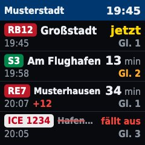

**English version: [README.md](README.md)**

# Glance Box

Glance Box macht aus dem **GeekMagic SmallTV Ultra** (ein kleines WLAN-Display mit 240x240 Pixeln) ein winziges Web-Display. Du schreibst die Seiten als HTML oder richtest den Server auf irgendeine Webseite, und das Display zeigt sie der Reihe nach an: Abfahrten, eine Uhr, eine Statusseite aus deinem Home Assistant, alles, was auf 240x240 Pixel passt.

Das Projekt hat zwei Teile:

```
config.yaml ──▶ Glance-Box-Server (Docker) ──JPEG über HTTP──▶ Glance-Box-Firmware (SmallTV Ultra)
                 rendert deine Seiten
                 mit Headless-Chromium
```

- **Firmware** (Open Source, ESP8266): zeigt die Bilder an, hat ein WLAN-Einrichtungsportal, eine kleine Webseite für die Einstellungen und passwortgeschützte, geprüfte Updates über WLAN (OTA) mit einem Safe Mode, falls ein Update schiefgeht.
- **Server** (Docker, läuft auf einem PC, NAS oder Raspberry Pi): rendert deine Seiten nach einer Playlist zu kleinen JPEG-Bildern und liefert sie ans Display.



## Was du brauchst

- Einen **GeekMagic SmallTV Ultra** (Version mit ESP8266). Der SmallTV Pro (ESP32) und andere Modelle werden **nicht** unterstützt.
- Einen Computer oder kleinen Server im Heimnetz, auf dem Docker läuft (amd64 oder arm64, zum Beispiel ein Raspberry Pi 4).
- Ein 2,4-GHz-WLAN. Server und Display müssen im selben Netzwerk sein.
- Dringend empfohlen: einen USB-Seriell-Adapter (Raspberry Pi Pico oder CH340-Modul) und einen feinen Lötkolben oder Prüfklemmen für eine Sicherung der Original-Firmware. Siehe den Warnhinweis unten.

## Warnung

> [!WARNING]
> **Ohne serielle Sicherung gibt es keinen Weg zurück zur Original-Firmware.** Die Original-Firmware ist an dein Gerät gebunden (der Aktivierungscode hängt an der MAC-Adresse), und niemand stellt ein Abbild bereit, das du stattdessen aufspielen könntest. Wenn du später zurück willst, mach **vor** dem ersten Flashen eine serielle Sicherung des Flash-Speichers, prüfe sie doppelt und bewahre sie sicher auf. Siehe [docs/de/flashing.md](docs/de/flashing.md).
>
> Beim Flashen wird die Firmware deines Geräts ersetzt. Das machst du auf eigene Gefahr. Das Projekt kommt ohne jede Gewährleistung (MIT-Lizenz).

## Schnellstart

### 1. Server starten

```sh
git clone https://github.com/robinlanger/glancebox.git
cd glancebox
cp config.example.yaml config.yaml
mkdir pages-custom
```

Öffne `config.yaml` und passe die Seiten an (mindestens den Bahnhof der `bahn`-Seite, oder entferne die Seite; entferne oder ändere die `url`-Seite). Dann:

```sh
docker compose up -d --build
docker compose logs -f
```

Öffne `http://<server-ip>:8080/` im Browser. Du solltest eine Vorschau jeder Seite sehen. Mehr dazu: [docs/de/configuration.md](docs/de/configuration.md).

### 2. Display flashen und einrichten

Lade `glancebox-ultra-<version>.bin` und die zugehörige `.md5`-Datei von der [Releases-Seite](https://github.com/robinlanger/glancebox/releases) herunter. Folge dann [docs/de/flashing.md](docs/de/flashing.md) (erstes Flashen über die Original-Weboberfläche) und [docs/de/setup.md](docs/de/setup.md) (WLAN, Serveradresse und Update-Passwort).

## Dokumentation

| Thema | English | Deutsch |
| --- | --- | --- |
| Erstes Flashen, Sicherung | [flashing.md](docs/en/flashing.md) | [flashing.md](docs/de/flashing.md) |
| WLAN-Einrichtung, Passwort | [setup.md](docs/en/setup.md) | [setup.md](docs/de/setup.md) |
| Server-Konfiguration | [configuration.md](docs/en/configuration.md) | [configuration.md](docs/de/configuration.md) |
| Eigene Seiten schreiben | [writing-pages.md](docs/en/writing-pages.md) | [writing-pages.md](docs/de/writing-pages.md) |
| Firmware aktualisieren | [updating.md](docs/en/updating.md) | [updating.md](docs/de/updating.md) |
| Safe Mode, serielle Rettung | [recovery.md](docs/en/recovery.md) | [recovery.md](docs/de/recovery.md) |

Für Maintainer: [docs/RELEASING.md](docs/RELEASING.md) (nur Englisch).

## Aus dem Quellcode bauen

Die meisten brauchen das nie: Auf der Releases-Seite liegt die fertige Firmware, und das Server-Image baut `docker compose up --build` selbst.

- Server: `python -m glancebox serve` im Ordner `server/` (Python 3.12, siehe `server/pyproject.toml`) oder `docker compose build`.
- Firmware: [PlatformIO](https://platformio.org/) installieren und in `firmware/` `pio run -e ultra` ausführen. Auf einem **Mac mit Apple Silicon** gibt es die ESP8266-Toolchain nur für x86. Du brauchst also Rosetta oder baust in einem Docker-Container.

## Danksagung

- **[DBF / db-infoscreen](https://dbf.finalrewind.org)** von derf liefert die Abfahrtsdaten für die `bahn`-Seite. Bitte geh sorgsam mit diesem kostenlosen Dienst um; die Seite hält sich an seine Regel von höchstens einer Anfrage pro Bahnhof und Minute.
- Die **ESPHome-Community** hat die Pinbelegung der SmallTV-Displays herausgefunden (SPI-Pins, Hintergrundbeleuchtung, kein Chip-Select). Erst dadurch wurde eine offene Firmware möglich.
- **[TJpgDec](http://elm-chan.org/fsw/tjpgd/)** von ChaN (mitgeliefert, sein Lizenzkopf bleibt erhalten) dekodiert die JPEG-Bilder auf dem Gerät.
- **[TFT_eSPI](https://github.com/Bodmer/TFT_eSPI)** von Bodmer steuert das Display an.
- **[WiFiManager](https://github.com/tzapu/WiFiManager)** von tzapu liefert das WLAN-Einrichtungsportal.
- Die DejaVu-Schriften (im Server enthalten, Lizenz in `server/glancebox/fonts/`).

## Lizenz

MIT, siehe [LICENSE](LICENSE).
