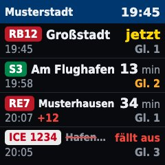

**Deutsche Version: [README.de.md](README.de.md)**

# Glance Box

Glance Box turns the **GeekMagic SmallTV Ultra** (a small 240x240 Wi-Fi display) into a tiny web display. You write the pages as HTML, or point the server at any web page, and the display shows them in turn: departures, a clock, a status page from your Home Assistant, whatever fits on 240x240 pixels.

It has two parts:

```
config.yaml ──▶ Glance Box server (Docker) ──JPEG over HTTP──▶ Glance Box firmware (SmallTV Ultra)
                 renders your pages
                 with headless Chromium
```

- **Firmware** (open source, ESP8266): shows the frames, has a Wi-Fi setup portal, a small web page for settings, and password-protected, verified over-the-air updates with a safe mode if an update goes wrong.
- **Server** (Docker, runs on a PC, NAS or Raspberry Pi): renders your pages to small JPEG images on a playlist and serves them to the display.



## What you need

- A **GeekMagic SmallTV Ultra** (ESP8266 version). The SmallTV Pro (ESP32) and other models are **not** supported.
- A computer or small server in your home network that runs Docker (amd64 or arm64, for example a Raspberry Pi 4).
- A 2.4 GHz Wi-Fi network. The server and the display must be in the same network.
- Strongly recommended: a USB-to-serial adapter (a Raspberry Pi Pico or a CH340 module) and a thin soldering iron or clip leads for a backup of the original firmware. See the warning below.

## Warning

> [!WARNING]
> **There is no way back to the original firmware without a serial backup.** The stock firmware is tied to your device (the activation code is bound to the MAC address), and nobody offers an image you could flash instead. If you want to be able to go back, make a serial backup of the flash **before** the first flash, check it twice and keep it safe. See [docs/en/flashing.md](docs/en/flashing.md).
>
> Flashing replaces the firmware on your device. You do this at your own risk. The project comes without any warranty (MIT license).

## Quickstart

### 1. Start the server

```sh
git clone https://github.com/robinlanger/glancebox.git
cd glancebox
cp config.example.yaml config.yaml
mkdir pages-custom
```

Open `config.yaml` and adjust the pages (at least the station of the `bahn` page, or remove the page; remove or change the `url` page). Then:

```sh
docker compose up -d --build
docker compose logs -f
```

Open `http://<server-ip>:8080/` in your browser. You should see a preview of every page. Details: [docs/en/configuration.md](docs/en/configuration.md).

### 2. Flash and set up the display

Download `glancebox-ultra-<version>.bin` and its `.md5` file from the [releases page](https://github.com/robinlanger/glancebox/releases), then follow [docs/en/flashing.md](docs/en/flashing.md) (first flash through the stock web interface) and [docs/en/setup.md](docs/en/setup.md) (Wi-Fi, server address and update password).

## Documentation

| Topic | English | Deutsch |
| --- | --- | --- |
| First flash, backup | [flashing.md](docs/en/flashing.md) | [flashing.md](docs/de/flashing.md) |
| Wi-Fi setup, password | [setup.md](docs/en/setup.md) | [setup.md](docs/de/setup.md) |
| Server configuration | [configuration.md](docs/en/configuration.md) | [configuration.md](docs/de/configuration.md) |
| Template catalog (pages with previews) | [README.md](docs/en/templates/README.md) | [README.md](docs/de/templates/README.md) |
| Writing your own pages | [writing-pages.md](docs/en/writing-pages.md) | [writing-pages.md](docs/de/writing-pages.md) |
| Updating the firmware | [updating.md](docs/en/updating.md) | [updating.md](docs/de/updating.md) |
| Safe mode, serial recovery | [recovery.md](docs/en/recovery.md) | [recovery.md](docs/de/recovery.md) |

Maintainers: [docs/RELEASING.md](docs/RELEASING.md) (English only).

## Building from source

Most people never need this: the release page has the ready-made firmware, and the server image is built by `docker compose up --build`.

- Server: `python -m glancebox serve` from `server/` (Python 3.12, see `server/pyproject.toml`), or `docker compose build`.
- Firmware: install [PlatformIO](https://platformio.org/) and run `pio run -e ultra` in `firmware/`. On an **Apple Silicon Mac** the ESP8266 toolchain is x86-only, so you need Rosetta or you build inside a Docker container.

## Credits

- **[DBF / db-infoscreen](https://dbf.finalrewind.org)** by derf provides the departure data for the `bahn` page. Please be kind to this free service; the page respects its rule of at most one request per station and minute.
- **[Open-Meteo](https://open-meteo.com)** provides the weather data for the `weather` page (CC BY 4.0). Please be kind to this free service; the page asks at most every 15 minutes.
- The **ESPHome community** worked out the pinout of the SmallTV displays (SPI pins, backlight, no chip-select), which made an open firmware possible.
- **[TJpgDec](http://elm-chan.org/fsw/tjpgd/)** by ChaN (vendored, its license header is kept) decodes the JPEG frames on the device.
- **[TFT_eSPI](https://github.com/Bodmer/TFT_eSPI)** by Bodmer drives the display.
- **[WiFiManager](https://github.com/tzapu/WiFiManager)** by tzapu provides the Wi-Fi setup portal.
- The DejaVu fonts (bundled with the server, license in `server/glancebox/fonts/`).

## License

MIT, see [LICENSE](LICENSE).
