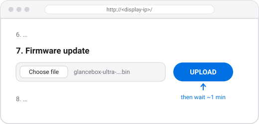

# Firmware flashen

Schritt 3 von 5 · etwa 5 Minuten · ohne Löten

Du installierst Glance Box über die Update-Seite der Original-Firmware, im Browser.

## Die Datei holen

1. Öffne den [neuesten Release](https://github.com/robinlanger/glancebox/releases/latest) und lade `glancebox-ultra-<version>.bin` herunter.

## Hochladen

1. Schließ das Display an und lass es mit der Original-Firmware in dein WLAN. Seine IP-Adresse steht auf dem Display (oder in der Geräteliste deines Routers).
2. Öffne `http://<display-ip>/` in einem Browser im selben Netz.
3. Such den Bereich für das **Firmware-Update**. Auf einem getesteten Ultra heißt er **„7. Firmware update“** und hat einen Knopf **UPLOAD**.

    <figure class="gb-figure" markdown>
    { width="520" }
    </figure>

4. Wähl `glancebox-ultra-<version>.bin` und starte den Upload.
5. **Warte etwa eine Minute und zieh das Display nicht ab.** Es startet von selbst neu.

!!! tip "Upload abgelehnt?"
    Dann hat sich nichts geändert, und das Display behält die Original-Firmware. Prüf, ob du die `.bin` für den **Ultra** geladen hast und der Download vollständig ist.

Nach dem Neustart zeigt das Display **„Glance Box setup“** und einen WLAN-Namen wie `GlanceBox-A1B2`. Das ist der nächste Schritt.
