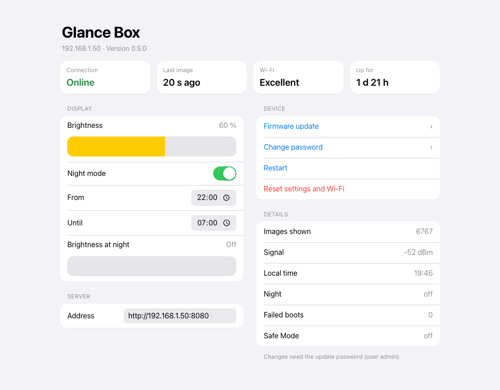

# Seiten auswählen

<p class="gb-meta">Schritt 5 von 5 · so lange du magst</p>
<div class="gb-progress" aria-hidden="true"><span class="on"></span><span class="on"></span><span class="on"></span><span class="on"></span><span class="on"></span></div>

Dein Display läuft. Jetzt zeigt es, was dich interessiert.

## Fertige Seiten eintragen

1. Such dir Seiten im [Vorlagen-Katalog](../templates/README.md) aus: Abfahrten, Uhr, Wetter, Uptime Kuma, Home Assistant, KI-Verbrauch.
2. Kopier das Beispiel jeder Seite in die Liste `pages:` in `config.yaml`.
3. Starte den Server neu:

    ```sh
    docker compose restart
    ```

    Das Display zeigt die Seiten nacheinander, jede für `interval` Sekunden (Standard 30).

## Die Geräteseite nutzen

1. Öffne `http://<display-ip>/` im Browser.
2. Zieh den Regler **Helligkeit**: Das Display folgt beim Ziehen. Stell einen **Nachtmodus** mit eigener Helligkeit ein, oder ganz dunkel.

<figure class="gb-figure" markdown>

</figure>

Jede Änderung wird von selbst gespeichert. Details: [Geräteseite & Nachtmodus](../setup.md#die-geräteseite).

## Wie es weitergeht

- [Eigene Seiten schreiben](../writing-pages.md) in HTML, oder eine beliebige Webseite zeigen.
- [Die Firmware aktualisieren](../updating.md), wenn ein neuer Release erscheint.
- Etwas stimmt nicht? [Notfall & Wiederherstellung](../recovery.md) erklärt den Safe Mode und den Weg zurück.
