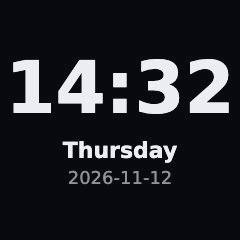
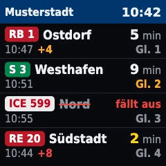

# Vorlagen-Katalog

Fertige Seiten für das Display. Jede hat eine eigene Seite mit Beispielbild, allen Optionen, Einrichtung und Hinweisen zum Datenschutz. Trage eine Seite in die Liste `pages:` der `config.yaml` ein und starte den Server neu, siehe [Server-Konfiguration](../configuration.md).

## Zeit & Wetter

### clock

Große Uhr mit Wochentag und Datum, zugleich der Ausgangspunkt für eigene Seiten. [Details](clock.md)

## Server & Smart Home

## KI & Entwicklung

## Verkehr

### bahn

Live-Abfahrten für einen deutschen Bahnhof mit Verspätungen, Gleiswechseln und Ausfällen. [Details](bahn.md)

## Eigene Seiten

Eine Seite besteht aus einem Ordner mit einer kleinen Python-Datei und einer Jinja-Vorlage. [Eigene Seiten schreiben](../writing-pages.md) führt Schritt für Schritt durch.
