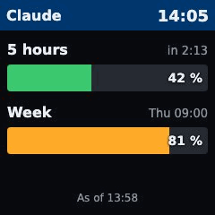

# ai



## Was sie zeigt

Wie viel von einem KI-Abo oder -Budget verbraucht ist. Jede Seite zeigt einen Anbieter, den du mit `provider:` wählst. Wer mehrere nutzt, trägt mehrere Seiten ein.

| `provider` | Zeigt | Wie die Daten ankommen |
| --- | --- | --- |
| `claude` | Die Limits deines Claude-Abos: das 5-Stunden-Fenster und die Woche, jeweils in Prozent mit der Zeit des nächsten Resets | Claude Code auf deinem Rechner schickt sie an den Server (Push) |

Für jedes Limit gibt es eine Zeile mit dem Namen und rechts der Zeit des Resets, darunter einen breiten Balken mit dem Wert darin. Der Balken ist grün, ab 75 % orange und ab 90 % rot.

Für `claude`:

- **Reset:** weniger als einen Tag entfernt als `in 2:13` (Stunden:Minuten), sonst als Wochentag und Uhrzeit, zum Beispiel `Do 09:00`. Ist die Reset-Zeit schon vorbei, zeigt der Balken `0 %` und `zurückgesetzt`.
- **Alter:** unten zeigt die Seite immer, wann die Werte ankamen, zum Beispiel `Stand 13:58`.
- **Noch keine Daten:** bis die ersten Werte ankommen, zeigt die Seite den Hinweis `Noch keine Daten` mit `Statuszeilen-Skript einrichten`.
- **Keine Limitdaten:** Werte kamen an, enthalten aber keine Limits. Claude Code schickt sie nur mit einem Claude-Abo (Pro oder Max), nicht mit einem API-Key.
- Hat dein Abo kein Wochenlimit, erscheint nur der 5-Stunden-Balken.

## Was du brauchst

Für `claude`:

- Ein Claude-Abo (Pro oder Max) und [Claude Code](https://code.claude.com/docs) auf einem Rechner im selben Heimnetz wie der Glance-Box-Server.
- `curl` auf diesem Rechner (macOS und Linux haben es). Unter Windows reicht PowerShell.
- Das Skript `tools/statusline/glancebox-statusline.sh` (macOS, Linux) oder `tools/statusline/glancebox-statusline.ps1` (Windows) aus diesem Repository auf diesem Rechner.

Claude Code gibt seiner [Statuszeile](https://code.claude.com/docs/en/statusline) nach jeder Antwort einen kleinen JSON-Text. Darin stehen deine Limits (`rate_limits`). Das Skript reicht diesen Text im Hintergrund an den Server weiter und zeigt danach deine normale Statuszeile.

## Beispiel

```yaml
- type: ai
  provider: claude
  lang: de
  refresh: 30
```

## Optionen

| Schlüssel | Standard | Bedeutung |
| --- | --- | --- |
| `provider` | | Woher die Werte kommen: `claude`. Pflicht. |
| `title` | Name des Anbieters (`Claude`) | Text der Kopfzeile. |
| `lang` | oberstes `lang` | `de` oder `en`. Legt alle Texte der Seite fest. |
| `refresh` | Standard-`refresh` | Für `claude` empfehlen wir `30`. Die Seite liest nur, was angekommen ist, das kostet nichts. |
| `duration` | `interval` | Wie viele Sekunden die Seite auf dem Display bleibt. |

## Einrichtung

### Claude

1. **Schlüssel für den Server.** Erzeuge einen Schlüssel mit `openssl rand -hex 24` und trage ihn in `.env` neben `docker-compose.yml` ein:

   ```
   GLANCEBOX_PUSH_KEY=<der Schlüssel>
   ```

   In `config.yaml` auf oberster Ebene ergänzen:

   ```yaml
   push_key: ${GLANCEBOX_PUSH_KEY}
   ```

2. **Die Seite.** Füge das Beispiel in die Liste `pages:` in `config.yaml` ein und führe `docker compose up -d` aus (ein einfaches `restart` liest `.env` nicht neu).

3. **Einstellungen auf deinem Rechner.** Lege die Datei `~/.config/glancebox/push.env` mit der Adresse des Servers und demselben Schlüssel an und mache sie nur für dich lesbar:

   ```sh
   mkdir -p ~/.config/glancebox
   cat > ~/.config/glancebox/push.env <<'EOF'
   GLANCEBOX_URL=http://192.168.1.10:8080
   GLANCEBOX_PUSH_KEY=<der Schlüssel>
   EOF
   chmod 600 ~/.config/glancebox/push.env
   ```

   Nimm die Adresse deines Servers im Heimnetz. Ist `XDG_CONFIG_HOME` gesetzt, gehört die Datei nach `$XDG_CONFIG_HOME/glancebox/push.env`.

4. **Das Skript.** Kopiere `tools/statusline/glancebox-statusline.sh` an einen Ort deiner Wahl, zum Beispiel `~/.claude/glancebox-statusline.sh`, und mache es mit `chmod +x` ausführbar.

5. **Claude Code.** Ergänze in `~/.claude/settings.json`:

   ```json
   {
     "statusLine": {
       "type": "command",
       "command": "~/.claude/glancebox-statusline.sh"
     }
   }
   ```

   Das Skript selbst gibt nichts aus, die Statuszeile bleibt also leer.

6. **Prüfen.** Frag Claude Code etwas. Öffne nach der Antwort `http://<server>:8080/` und warte auf das nächste Neuladen der Seite (bis zu 30 Sekunden).

### Eigene Statuszeile behalten

Hast du schon eine Statuszeile, gib ihren Befehl dem Skript als Argumente mit. Das Skript reicht ihr dasselbe JSON weiter, und ihre Ausgabe bleibt deine Statuszeile:

```json
{
  "statusLine": {
    "type": "command",
    "command": "~/.claude/glancebox-statusline.sh ~/.claude/my-statusline.sh"
  }
}
```

### Windows

1. Lege `%APPDATA%\glancebox\push.env` mit denselben zwei Zeilen wie in Schritt 3 an.
2. Kopiere `tools\statusline\glancebox-statusline.ps1`, zum Beispiel nach `%USERPROFILE%\.claude\`.
3. In `%USERPROFILE%\.claude\settings.json`:

   ```json
   {
     "statusLine": {
       "type": "command",
       "command": "powershell -NoProfile -ExecutionPolicy Bypass -File C:/Users/<du>/.claude/glancebox-statusline.ps1"
     }
   }
   ```

   Schreib den Pfad mit Schrägstrichen `/`: Claude Code führt den Befehl unter Umständen über Git Bash aus, und Git Bash verschluckt Backslashes. Eine vorhandene Statuszeile kommt wie oben ans Ende des Befehls. Mit installiertem Git Bash kannst du auch das `.sh`-Skript wie unter macOS nehmen.

### Grenzen

- Die Werte werden nur aktuell, solange Claude Code läuft und antwortet, und nur, solange dein Rechner im Heimnetz ist. Unterwegs schlägt das Senden leise fehl, und die Seite zeigt weiter die letzten Werte mit ihrer Uhrzeit (`Stand 13:58`).
- Der Server hält die Werte nur im Arbeitsspeicher. Nach einem Neustart des Servers zeigt die Seite `Noch keine Daten`, bis Claude Code die nächste Antwort gibt.
- Eine neue Claude-Code-Sitzung schickt ihre Limits erst nach ihrer ersten Antwort.

## Datenschutz & Sicherheit

- **Nur `rate_limits` wird gespeichert.** Das JSON der Statuszeile enthält auch Dinge wie den Arbeitsordner und die Sitzungs-ID. Der Server verwirft sofort alles außer `rate_limits`, schreibt nichts auf die Platte und protokolliert den Inhalt nicht.
- **Kein Anthropic-Token verlässt deinen Rechner.** Das Skript schickt nur den Text, den Claude Code der Statuszeile gibt, zusammen mit dem Glance-Box-Schlüssel. Der Server meldet sich nie bei Anthropic an.
- **Der Push-Schlüssel** erlaubt nur, Werte an dein Display zu schicken. Bewahre ihn in `.env` auf dem Server und in `push.env` (`chmod 600`) auf deinem Rechner auf, nie in `config.yaml`.
- Der Server und sein Daten-Eingang sind nur für dein Heimnetz gedacht. Mach sie nicht aus dem Internet erreichbar.

## Wenn etwas nicht stimmt

- **`Noch keine Daten` bleibt:** prüfe, dass `push_key` gesetzt ist und du nach der Änderung an `.env` `docker compose up -d` ausgeführt hast. Teste dann den Weg von deinem Rechner zum Server: `curl -i -X POST -H "Authorization: Bearer <der Schlüssel>" -H "Content-Type: application/json" -d '{"rate_limits":{}}' http://<server>:8080/api/v1/push/claude`. `204` ist richtig (die Seite zeigt dann `Keine Limitdaten` bis zur nächsten Antwort von Claude Code), `401` heißt, der Schlüssel stimmt nicht, `404` heißt, der Server hat keinen `push_key`. Klappt `curl`, prüfe `push.env` (beide Zeilen, keine Leerzeichen um `=`) und den Pfad in `settings.json`.
- **`Keine Limitdaten`:** Claude Code hat keine Limits geschickt. Das passiert mit einem API-Key statt eines Claude-Abos und mit älteren Claude-Code-Versionen.
- **Die Statuszeile ist leer:** das ist ohne eigene Statuszeile normal. Um eine zu zeigen, gib ihren Befehl als Argumente mit.
- **Der Server startet nicht und nennt `provider`:** der Wert muss einer der Anbieter aus der Tabelle oben sein.
