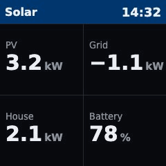
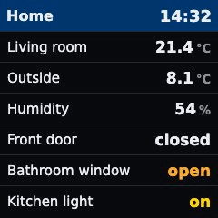

# homeassistant




## Was sie zeigt

Den aktuellen Zustand von bis zu sechs Entitäten aus deinem [Home Assistant](https://www.home-assistant.io/), zum Beispiel Solarleistung, Temperaturen oder offene Fenster.

- **Layout `tiles`:** ein bis vier große Werte. Ein Wert füllt den Bildschirm, zwei stehen übereinander, drei sind eine breite Kachel über zwei kleinen, vier ein 2x2-Raster. Jede Kachel hat oben eine kleine graue Beschriftung und darunter den Wert mit Einheit.
- **Layout `list`:** bis zu sechs Zeilen, links die Beschriftung, rechts der Wert.
- **Zahlen** werden gerundet: Ganzzahlen bleiben ganzzahlig, sonst eine Nachkommastelle, oder genau `decimals`, wenn du es setzt. Werte in `W` oder `Wh` ab 1000 erscheinen als `kW` oder `kWh`. Negative Werte bekommen ein echtes Minuszeichen (`−1,1 kW`). Mit `lang: de` steht ein Komma vor den Nachkommastellen.
- **Wörter statt on/off:** Tür-, Fenster-, Öffnungs- und Garagentor-Sensoren zeigen `offen`/`zu`, und `offen` ist orange. Bewegungs-, Belegungs- und Anwesenheitssensoren zeigen `erkannt`/`frei`. Lichter, Schalter, `input_boolean`, Ventilatoren und sonstige Binärsensoren zeigen `an`/`aus`; `an` ist bei Lichtern und Schaltern gelb. Jeder andere Text erscheint so, wie Home Assistant ihn liefert.
- **Beschriftung:** dein `label`, sonst der Anzeigename der Entität in Home Assistant, sonst die Entity-ID. Lange Beschriftungen werden mit `…` gekürzt.
- **Breite Werte:** lange Zahlen bekommen eine kleinere Schrift. Langer Text wird mit `…` gekürzt, damit er in seiner Kachel oder Zeile bleibt.
- **Eine Entität nicht verfügbar:** diese Zelle zeigt `n. v.` in Orange, die anderen laufen weiter. Eine Entität, die es nicht gibt, zeigt `fehlt` in Orange.
- **Keine Verbindung:** ein oranger Hinweis `Keine Verbindung zu Home Assistant` mit der Uhrzeit des letzten Versuchs (`Stand 14:32`). Die Seite zeigt nie alte Werte weiter.
- **Token nicht angenommen:** ein oranger Hinweis `Token abgelehnt` mit `Long-Lived Access Token prüfen`.

Die Kopfzeile wird nie rot.

## Was du brauchst

- Ein laufendes Home Assistant, das der Glance-Box-Server über das Netzwerk erreicht.
- Einen langlebigen Zugangstoken (Long-Lived Access Token) eines Home-Assistant-Benutzers.
- Die Entity-IDs, die du zeigen willst, zum Beispiel `sensor.pv_power`. Du findest sie in Home Assistant unter **Einstellungen → Geräte & Dienste → Entitäten**.

### 1. Benutzer für Glance Box anlegen (empfohlen)

Ein Token kann alles, was sein Benutzer kann (siehe [Datenschutz & Sicherheit](#datenschutz--sicherheit)). Lege deshalb für das Display einen eigenen Benutzer an, statt dein eigenes Konto zu nehmen: in Home Assistant unter **Einstellungen → Personen → Person hinzufügen**, schalte **Anmelden erlauben** ein und vergib Benutzername und Passwort. Lass **Administrator** aus.

### 2. Langlebigen Zugangstoken erstellen

Melde dich als dieser Benutzer in Home Assistant an. Klicke unten links auf deinen Benutzernamen, öffne den Reiter **Sicherheit**, scrolle zu **Langlebige Zugangstoken** und klicke auf **Token erstellen**. Gib ihm einen Namen wie `Glance Box` und kopiere den Token. Home Assistant zeigt ihn nur einmal.

### 3. Adresse und Token in die `.env`

Trage beides in die Datei `.env` neben der `docker-compose.yml` ein:

```
HA_URL=http://homeassistant.lan:8123
HA_TOKEN=<der Token>
```

Nimm die Adresse deines Home Assistant im Heimnetz, ohne `/api` am Ende. In die `config.yaml` schreibst du nur `${HA_URL}` und `${HA_TOKEN}`, siehe [Geheimnisse und Umgebungsvariablen](../configuration.md#geheimnisse-und-umgebungsvariablen).

## Beispiel

Vier Werte als Kacheln:

```yaml
- type: homeassistant
  url: ${HA_URL}
  token: ${HA_TOKEN}
  title: Solar
  lang: de
  refresh: 30
  entities:
    - entity: sensor.pv_power
      label: PV
    - entity: sensor.grid_power
      label: Netz
    - entity: sensor.house_power
      label: Haus
    - entity: sensor.battery_level
      label: Akku
```

Sechs Zeilen als Liste, mit den Namen aus Home Assistant:

```yaml
- type: homeassistant
  url: ${HA_URL}
  token: ${HA_TOKEN}
  title: Zuhause
  entities:
    - sensor.living_room_temperature
    - sensor.outside_temperature
    - sensor.living_room_humidity
    - binary_sensor.front_door
    - binary_sensor.bathroom_window
    - light.kitchen
```

## Optionen

| Schlüssel | Standard | Bedeutung |
| --- | --- | --- |
| `url` | | Adresse deines Home Assistant, beginnend mit `http://` oder `https://`, ohne `/api`. Pflicht. Am besten als `${HA_URL}` aus der `.env`. |
| `token` | | Langlebiger Zugangstoken. Pflicht. Immer als `${HA_TOKEN}` aus der `.env`, nie direkt in die `config.yaml` schreiben. |
| `entities` | | Liste mit 1 bis 6 Entitäten. Pflicht. Jeder Eintrag ist entweder eine Entity-ID (`sensor.pv_power`) oder ein Objekt mit `entity` (Pflicht), `label` und `decimals`. Eine Entity-ID hat die Form `domain.name` aus Kleinbuchstaben, Ziffern und `_`. |
| `entities[].label` | Anzeigename aus Home Assistant, sonst die Entity-ID | Eigene Beschriftung für diese Entität. |
| `entities[].decimals` | Ganzzahlen bleiben ganzzahlig, sonst 1 | Nachkommastellen, `0` bis `3`. |
| `layout` | `tiles` bei 1 bis 4 Entitäten, sonst `list` | `tiles` oder `list`. `tiles` erlaubt höchstens 4 Entitäten. |
| `title` | `Home Assistant` | Text der Kopfzeile. |
| `lang` | oberstes `lang` | `de` oder `en`. Bestimmt alle Texte und das Zahlenformat. |
| `refresh` | Standard-`refresh` | Wir empfehlen `30`. Die Seite fragt Home Assistant bei jeder Aktualisierung einmal pro Entität. |
| `duration` | `interval` | Wie viele Sekunden die Seite auf dem Display bleibt. |

## Einrichtung

1. Trage `HA_URL` und `HA_TOKEN` wie oben beschrieben in die `.env` ein.
2. Trage das Beispiel mit deinen Entity-IDs in die Liste `pages:` der `config.yaml` ein.
3. Führe `docker compose up -d` aus. Ein einfaches `docker compose restart` liest die `.env` nicht neu.
4. Öffne `http://<Server>:8080/` und prüfe die Vorschau.

## Datenschutz & Sicherheit

- **Der Token hat alle Rechte des Benutzers, der ihn erstellt hat.** Home Assistant kennt keine Nur-Lese-Tokens: Ein langlebiger Zugangstoken funktioniert genau wie ein normaler Zugangstoken dieses Benutzers. Glance Box liest nur die Zustände der Entitäten, die du einträgst, aber wer den Token bekommt, kann mehr.
- **Auch ein Benutzer ohne Administratorrechte kann viel.** Laut Home-Assistant-Dokumentation haben die eingebauten Gruppen „Users“ und „Administrators“ dieselben Rechte auf Entitäten: „Users and administrators can control the same entities“ ([Permissions](https://contributors.home-assistant.io/core/internals/permissions/)). Administratoren dürfen zusätzlich die Konfiguration ändern. Ein Token eines Nicht-Admins kann also trotzdem alle Entitäten lesen und schalten. Deshalb empfehlen wir einen eigenen Benutzer für Glance Box: Du siehst, was er tut, und kannst seinen Token oder den ganzen Benutzer jederzeit entfernen, ohne dein eigenes Konto anzufassen.
- **Der Token gehört nur in die `.env`.** Schreib `${HA_TOKEN}` in die `config.yaml` und gib die `.env` nie weiter. Der Server schickt den Token nur an dein Home Assistant, im Header `Authorization`, und schreibt ihn nie ins Log.
- **Stell Home Assistant nicht nur für diese Seite ins Internet.** Der Glance-Box-Server muss es nur in deinem Heimnetz erreichen.
- Auf dem Glance-Box-Server wird nichts gespeichert außer dem aktuellen Bild.

## Wenn etwas nicht stimmt

- **`Keine Verbindung zu Home Assistant`:** der Server hat keine brauchbare Antwort bekommen, zum Beispiel weil die Adresse falsch ist, Home Assistant nicht läuft oder mit einem Fehler geantwortet hat. Prüfe `HA_URL` in der `.env` und führe nach einer Änderung `docker compose up -d` aus. Vom Server aus muss `curl -H "Authorization: Bearer <der Token>" http://homeassistant.lan:8123/api/` mit `{"message":"API running."}` antworten. Den Grund findest du in `docker compose logs`.
- **`Token abgelehnt`:** Home Assistant hat mit 401 oder 403 geantwortet. Der Token ist falsch, wurde in Home Assistant gelöscht, oder die Variable enthält etwas anderes. Erstelle einen neuen Token, trage ihn in die `.env` ein und führe `docker compose up -d` aus.
- **Eine Zelle zeigt `fehlt`:** Home Assistant kennt diese Entity-ID nicht. Prüfe die Schreibweise unter **Einstellungen → Geräte & Dienste → Entitäten**. Die Zelle behält dein `label`, sonst zeigt sie die Entity-ID. Zeigen alle Zellen `fehlt`, prüfe, dass `HA_URL` nicht mit `/api` endet.
- **Eine Zelle zeigt `n. v.`:** Home Assistant meldet die Entität als `unavailable` oder `unknown`, oder der Wert ist keine echte Zahl (`nan`, `inf`). Meist ist das Gerät dahinter offline. Prüfe die Entität in Home Assistant.
- **Der Server startet nicht und nennt eine Option dieser Seite:** die Meldung nennt die Stelle und was falsch ist. `url` muss mit `http://` oder `https://` beginnen; `token` muss gesetzt sein und darf keine Leerzeichen oder Zeilenumbrüche enthalten; `entities` braucht 1 bis 6 Einträge mit IDs wie `sensor.name`; `decimals` muss `0` bis `3` sein; `layout: tiles` erlaubt höchstens 4 Entitäten; `lang` muss `de` oder `en` sein; `title` muss Text sein.
