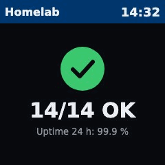
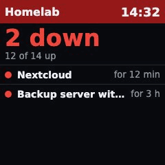

# kuma




## Was sie zeigt

Den Zustand einer [Uptime-Kuma](https://github.com/louislam/uptime-kuma)-Statusseite auf einen Blick.

- **Alles in Ordnung:** ein großes grünes Häkchen, `14/14 OK` und die durchschnittliche Verfügbarkeit der letzten 24 Stunden. Monitore, die noch geprüft werden (pending), bekommen eine orange Zeile, zum Beispiel `1 wird geprüft`. Monitore in Wartung zählen als in Ordnung.
- **Etwas gestört:** die Kopfzeile wird rot und zeigt, wie viele Dienste gestört sind (`2 gestört`), wie viele laufen, und eine Zeile je ausgefallenem Dienst mit der Zeit seit wann (`seit 12 min`, `seit 3 h`, `seit 2 d`). Es passen bis zu vier Zeilen. Weitere stehen als `+ 2 weitere`. Kennt Kuma für einen Dienst keinen früheren erfolgreichen Check, ist die Zeit eine Untergrenze, zum Beispiel `≥ 40 min`.
- **Keine Verbindung:** ein oranger Hinweis `Keine Verbindung zu Uptime Kuma` mit der Uhrzeit des letzten Versuchs. Die Seite zeigt nie ein altes „alles OK“ weiter.
- **Leere Statusseite:** der Hinweis `Keine Monitore auf der Statusseite`.
- **Nur pending:** läuft noch kein Monitor und werden alle noch geprüft, zum Beispiel direkt nach dem Start von Kuma, erscheint statt des grünen Häkchens ein oranger Hinweis `Wird geprüft` mit `0/3 OK`.

Pending und Wartung machen die Kopfzeile nie rot.

## Was du brauchst

- Ein laufendes Uptime Kuma 2.x, das der Glance-Box-Server über das Netzwerk erreicht.
- Eine Statusseite in Kuma, auf der deine Monitore stehen.

### 1. Uptime Kuma installieren

Falls du es noch nicht hast, lege auf einem Rechner im Heimnetz eine `docker-compose.yml` an:

```yaml
services:
  uptime-kuma:
    image: louislam/uptime-kuma:2
    restart: unless-stopped
    ports:
      - "3001:3001"
    volumes:
      - ./kuma-data:/app/data
```

Starte es mit `docker compose up -d`, öffne `http://<Rechner>:3001/` und lege das Admin-Konto an.

### 2. Monitore anlegen

Empfohlen sind **HTTP(s)-Monitore** auf die Webadressen deiner Dienste (Router-Seite, NAS, Pi-hole, Home Assistant, ...). Sie brauchen keine besonderen Rechte irgendwo.

### 3. Statusseite anlegen

Wähle in Kuma **Status Pages** und dann **New Status Page**. Vergib einen Namen und einen **Slug** (zum Beispiel `home`), füge deine Monitore einer Gruppe hinzu und speichere. Der Slug ist der letzte Teil der Adresse, `http://<Rechner>:3001/status/home`.

## Beispiel

```yaml
- type: kuma
  url: http://192.168.1.20:3001
  slug: home
  lang: de
  refresh: 30
```

## Optionen

| Schlüssel | Standard | Bedeutung |
| --- | --- | --- |
| `url` | | Adresse deines Uptime Kuma, beginnend mit `http://` oder `https://`, ohne den Teil `/status/...`. Pflicht. |
| `slug` | | Slug der Statusseite: Kleinbuchstaben, Ziffern und `-`. Pflicht. |
| `title` | Titel der Statusseite | Text der Kopfzeile. |
| `lang` | oberstes `lang` | `de` oder `en`. Bestimmt alle Texte der Seite. |
| `refresh` | Standard-`refresh` | Wir empfehlen `30`. Kuma hält die Antwort eine Minute im Zwischenspeicher, kleinere Werte bringen nichts. |
| `duration` | `interval` | Wie viele Sekunden die Seite auf dem Display bleibt. |

## Einrichtung

1. Trage das Beispiel mit deiner `url` und deinem `slug` in die Liste `pages:` der `config.yaml` ein.
2. Starte den Server neu: `docker compose restart`.
3. Öffne `http://<Server>:8080/` und prüfe die Vorschau.

## Datenschutz & Sicherheit

- **Die Statusseite kann jeder lesen, der Kuma erreicht.** Der Server liest nur diese öffentliche Seite und braucht weder Login noch Schlüssel. Setze keine Monitore darauf, deren Namen etwas verraten, das privat bleiben soll, und stelle Kuma nicht nur dafür ins Internet.
- Der **Docker-Container-Monitor** von Kuma gibt *Kuma* Zugriff auf Docker, und das ist Zugriff auf deinen ganzen Rechner. Nimm lieber HTTP(s)-Monitore. Willst du Container-Monitore trotzdem, schalte einen Socket-Proxy mit reinem Lesezugriff dazwischen, zum Beispiel `tecnativa/docker-socket-proxy` mit `CONTAINERS=1` und allen anderen Rechten auf `0`, und binde nie den rohen `/var/run/docker.sock` in Kuma ein.
- Auf dem Glance-Box-Server wird nichts gespeichert außer dem aktuellen Bild.

## Wenn etwas nicht stimmt

- **`Keine Verbindung zu Uptime Kuma`:** der Server hat die Statusseite nicht bekommen. Prüfe `url` und `slug`, ob Kuma läuft und ob die Statusseite veröffentlicht ist. Vom Server aus muss `curl http://<Rechner>:3001/api/status-page/<slug>` JSON liefern. Den Grund findest du in `docker compose logs`.
- **`Keine Monitore auf der Statusseite`:** die Statusseite gibt es, aber in keiner Gruppe steht ein Monitor.
- **Der Server startet nicht und nennt `slug` oder `url`:** der Slug darf nur Kleinbuchstaben, Ziffern und `-` enthalten; die URL muss mit `http://` oder `https://` beginnen.
- **Ein Dienst zeigt `≥ ...`:** Kuma hat im jüngsten Verlauf nur Fehl-Checks für ihn, der echte Ausfall kann also länger dauern.
