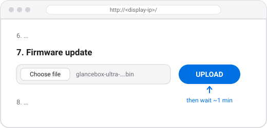

# Flash the firmware

Step 3 of 5 · about 5 minutes · no soldering

You install Glance Box through the update page of the stock firmware, in your browser.

## Get the file

1. Open the [latest release](https://github.com/robinlanger/glancebox/releases/latest) and download `glancebox-ultra-<version>.bin`.

## Upload it

1. Power the display and let it join your Wi-Fi with the stock firmware. Its IP address is shown on the display (or in your router's device list).
2. Open `http://<display-ip>/` in a browser in the same network.
3. Find the **firmware update** section. On a tested Ultra it is called **"7. Firmware update"** and has an **UPLOAD** button.

    <figure class="gb-figure" markdown>
    { width="520" }
    </figure>

4. Choose `glancebox-ultra-<version>.bin` and start the upload.
5. **Wait about a minute and do not unplug the display.** It restarts on its own.

!!! tip "Upload rejected?"
    Then nothing has changed and the display keeps the stock firmware. Check that you downloaded the `.bin` for the **Ultra** and that the download finished.

After the restart the display shows **"Glance Box setup"** and a Wi-Fi name like `GlanceBox-A1B2`. That is the next step.
