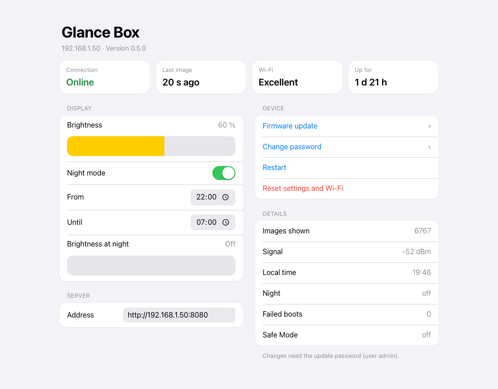

# Choose your pages

<p class="gb-meta">Step 5 of 5 · as long as you like</p>
<div class="gb-progress" aria-hidden="true"><span class="on"></span><span class="on"></span><span class="on"></span><span class="on"></span><span class="on"></span></div>

Your display works. Now make it show what you care about.

## Add ready-made pages

1. Pick pages from the [template catalog](../templates/README.md): departures, clock, weather, Uptime Kuma, Home Assistant, AI usage.
2. Copy the example of each page into the `pages:` list of `config.yaml`.
3. Restart the server:

    ```sh
    docker compose restart
    ```

    The display shows the pages one after another, each for `interval` seconds (default 30).

## Use the device page

1. Open `http://<display-ip>/` in your browser.
2. Drag the **brightness** slider: the display follows while you drag. Set a **night mode** with its own brightness, or completely dark.

<figure class="gb-figure" markdown>

</figure>

Every change is saved on its own. Details: [Device page & night mode](../setup.md#the-device-web-page).

## Where to go next

- [Write your own pages](../writing-pages.md) in HTML, or show any web page.
- [Update the firmware](../updating.md) when a new release comes out.
- Something wrong? [Recovery](../recovery.md) explains safe mode and how to get back.
