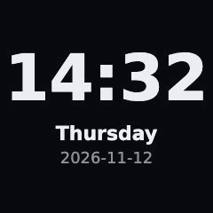
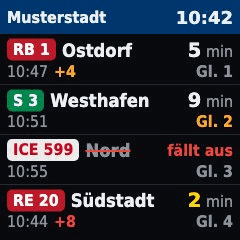

# Template catalog

Ready-made pages for the display. Each one has its own page with an example picture, all options, setup steps and notes on privacy. Add a page to the `pages:` list in `config.yaml` and restart the server, see [Server configuration](../configuration.md).

## Time & weather

### clock

A large clock with weekday and date, and the starting point for your own pages. [Details](clock.md)

## Server & smart home

## AI & development

## Transport

### bahn

Live departures for a German station with delays, platform changes and cancellations. [Details](bahn.md)

## Your own pages

Pages are a folder with a small Python file and a Jinja template. [Writing pages](../writing-pages.md) walks you through it.
