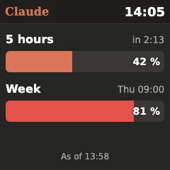
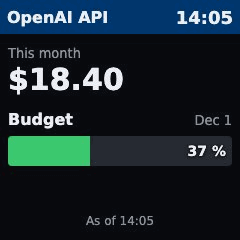

# ai




## What it shows

How much of an AI plan or budget you have used. Each page shows one provider, which you pick with `provider:`. If you use several, add several pages.

| `provider` | Shows | How the data gets there |
| --- | --- | --- |
| `claude` | Your Claude plan limits: the 5-hour window and the week, each in percent with the time of the next reset | Claude Code on your computer sends them to the server (push) |
| `anthropic-api` | Claude API cost of the current month in USD, optionally against your own budget | The server asks the Anthropic Usage and Cost Analytics API with an Admin key |
| `openai-api` | OpenAI API cost of the current month in USD, optionally against your own budget | The server asks the OpenAI Costs API with an Admin key |
| `xai-api` | Prepaid credit balance of your xAI team in USD | The server asks the xAI Management API with a management key |
| `copilot` | GitHub Copilot usage of the month (AI credits or premium requests) against the allowance of your plan, which you enter yourself | The server asks GitHub's billing usage API with a read-only token |

For each limit there is a line with its name and the time of the reset on the right, and below it a wide bar with the value inside. The bar is green, orange from 75 % and red from 90 %.

For `claude`:

- **Reset:** less than a day away as `in 2:13` (hours:minutes), otherwise as weekday and time, for example `Thu 09:00`. If the reset time has already passed, the bar shows `0 %` and `reset`.
- **Age:** at the bottom the page always shows when the values arrived, for example `As of 13:58`.
- **No data yet:** until the first values arrive the page shows the notice `No data yet` with `Set up the status-line script`.
- **No limit data:** values arrived but without usable limits, for example after the `curl` test under [When something is wrong](#when-something-is-wrong). The next answer of Claude Code brings the real values. Claude Code only has limits with a Claude plan (Pro or Max); with an API key the script sends nothing and the page stays on `No data yet`.
- If your plan has no weekly limit, only the 5-hour bar appears.

For `anthropic-api`, `openai-api` and `xai-api`:

- **Amount:** large in the middle, as `$18.40` (`This month`) or, for `xai-api`, `Balance`. The month is the calendar month in UTC, the way the providers bill.
- **Budget:** with `budget: 50` a bar `Budget` appears below the amount, with the share of the budget already spent and the day it starts again (`Dec 1`). Above 100 % the bar stays full and the text shows the real value, for example `120 %`.
- **Age:** at the bottom `As of 14:05` shows when the server last got the values. For `anthropic-api` it is the time of Anthropic's data export, which is updated about every 4 hours.
- **Only every 5 minutes:** cost data changes slowly. The server asks each provider at most every 5 minutes, whatever `refresh` says.
- **No data:** if the provider cannot be reached or refuses the key, the header turns red and the page shows `No data` with the time, never an old amount.

For `copilot`:

- **Bar:** `AI credits` (or `Premium requests`) with used / allowance, for example `1,234 / 1,500`, and on the right the day the allowance starts again (`Dec 1`, GitHub resets on the 1st at 00:00 UTC). Above it, large, what is `Left`.
- **Your allowance:** GitHub's API reports only what you used, not how much your plan includes. You enter that yourself with `monthly_allowance`, for example `1500` for Copilot Pro (see [GitHub Copilot](#github-copilot)).
- **Only plans you pay yourself:** usage of a Copilot seat that an organisation or company pays for is not in this API.
- Age, the 5-minute rhythm and `No data` work as for the cost providers.

## What you need

For `claude`:

- A Claude plan (Pro or Max) and [Claude Code](https://code.claude.com/docs) on a computer in the same home network as the Glance Box server.
- `curl` on that computer (macOS and Linux have it). On Windows, PowerShell is enough.
- The script `tools/statusline/glancebox-statusline.sh` (macOS, Linux) or `tools/statusline/glancebox-statusline.ps1` (Windows) from this repository on that computer.

For `anthropic-api`, `openai-api` and `xai-api`:

- An organisation (Anthropic, OpenAI) or a team (xAI) with API billing, and the right to create an Admin or management key there.
- Internet access for the Glance Box server.

For `copilot`:

- A Copilot plan you bought yourself (Pro, Pro+ or Max) on your GitHub account.
- A fine-grained personal access token with the read permission `Plan` (see [GitHub Copilot](#github-copilot)).
- Internet access for the Glance Box server.

Claude Code hands a small JSON text to its [status line](https://code.claude.com/docs/en/statusline) after every answer. It includes your limits (`rate_limits`). The script passes this text on to the server in the background and then shows your normal status line.

## Example

```yaml
- type: ai
  provider: claude
  lang: en
  refresh: 30
```

For the API costs, with the key in `.env` (see [Setup](#setup)):

```yaml
- type: ai
  provider: openai-api
  key: ${OPENAI_ADMIN_KEY}
  budget: 50
  lang: en
```

## Options

| Key | Default | Meaning |
| --- | --- | --- |
| `provider` | | Where the values come from: `claude`, `anthropic-api`, `openai-api`, `xai-api` or `copilot`. Required. |
| `key` | | Only `anthropic-api`, `openai-api`, `xai-api`, `copilot`, and required there: the Admin or management key, for `copilot` the GitHub token. Always as `${NAME}` from `.env`, never written into `config.yaml`. |
| `budget` | none | Only `anthropic-api` and `openai-api`: your monthly budget in USD, a positive number such as `50`. Adds the `Budget` bar. |
| `team_id` | | Only `xai-api`, and required there: the ID of your xAI team. |
| `username` | | Only `copilot`, and required there: your GitHub user name. |
| `monthly_allowance` | | Only `copilot`, and required there: how much your plan includes per month, a positive number such as `1500`. |
| `unit` | `ai-credits` | Only `copilot`: `ai-credits` (usage-based billing, the normal case) or `premium-requests` (an annual plan that stayed on premium requests). |
| `title` | name of the provider (`Claude`, `Anthropic API`, `OpenAI API`, `xAI API`, `GitHub Copilot`) | Header text. |
| `lang` | top-level `lang` | `de` or `en`. Sets all texts on the page. |
| `refresh` | `refresh` default | For `claude` we recommend `30`. The page only reads what arrived, so this costs nothing. The API providers ask at most every 5 minutes anyway. |
| `duration` | `interval` | How many seconds the page stays on the display. |

## Setup

### Claude

1. **Key for the server.** Create a key with `openssl rand -hex 24` and put it in `.env` next to `docker-compose.yml`:

   ```
   GLANCEBOX_PUSH_KEY=<the key>
   ```

   In `config.yaml` add at the top level:

   ```yaml
   push_key: ${GLANCEBOX_PUSH_KEY}
   ```

2. **The page.** Add the example to the `pages:` list in `config.yaml` and run `docker compose up -d` (a plain `restart` does not read `.env` again).

3. **Settings on your computer.** Create the file `~/.config/glancebox/push.env` with the address of the server and the same key, and make it readable only for you:

   ```sh
   mkdir -p ~/.config/glancebox
   cat > ~/.config/glancebox/push.env <<'EOF'
   GLANCEBOX_URL=http://192.168.1.10:8080
   GLANCEBOX_PUSH_KEY=<the key>
   EOF
   chmod 600 ~/.config/glancebox/push.env
   ```

   Use your server's address in the home network. If `XDG_CONFIG_HOME` is set, the file goes to `$XDG_CONFIG_HOME/glancebox/push.env`.

4. **The script.** Copy `tools/statusline/glancebox-statusline.sh` to a place of your choice, for example `~/.claude/glancebox-statusline.sh`, and make it executable with `chmod +x`.

5. **Claude Code.** Add to `~/.claude/settings.json`:

   ```json
   {
     "statusLine": {
       "type": "command",
       "command": "~/.claude/glancebox-statusline.sh"
     }
   }
   ```

   The script itself prints nothing, so the status line stays empty.

6. **Check.** Ask Claude Code something. After the answer, open `http://<server>:8080/` and wait for the next refresh of the page (up to 30 seconds).

### Keeping your own status line

If you already have a status line, pass its command to the script as arguments. The script hands it the same JSON, and its output stays your status line:

```json
{
  "statusLine": {
    "type": "command",
    "command": "~/.claude/glancebox-statusline.sh ~/.claude/my-statusline.sh"
  }
}
```

### Windows

1. Create `%APPDATA%\glancebox\push.env` with the same two lines as in step 3.
2. Copy `tools\statusline\glancebox-statusline.ps1`, for example to `%USERPROFILE%\.claude\`.
3. In `%USERPROFILE%\.claude\settings.json`:

   ```json
   {
     "statusLine": {
       "type": "command",
       "command": "powershell -NoProfile -ExecutionPolicy Bypass -File C:/Users/<you>/.claude/glancebox-statusline.ps1"
     }
   }
   ```

   Write the path with forward slashes `/`: Claude Code may run the command through Git Bash, which swallows backslashes. An existing status line goes at the end of the command, as above. With Git Bash installed you can also use the `.sh` script as on macOS.

### Limits

- The values only update while Claude Code runs and gives answers, and only while your computer is in your home network. Away from home the sending fails silently and the page keeps showing the last values with their time (`As of 13:58`).
- The server keeps the values in RAM only. After a restart of the server the page shows `No data yet` until Claude Code gives its next answer.
- A new Claude Code session sends its limits only after its first answer.

### Anthropic API

> **Warning:** an Anthropic Admin key controls the whole organisation: members, workspaces, all API keys and their limits. Whoever has it can do anything in the organisation, not only read costs. Use it only for an organisation that holds nothing else (a separate organisation just for this) or skip this provider.

1. Sign in to the Claude Console as an organisation admin, open the [Admin keys page](https://platform.claude.com/settings/admin-keys), click **Create admin key**, give it a name and an expiry date. Copy the key (it starts with `sk-ant-admin01-` and is shown only once). Console Admin keys have no scopes to choose: every key has full access.
2. Put it in `.env` next to `docker-compose.yml`:

   ```
   ANTHROPIC_ADMIN_KEY=sk-ant-admin...
   ```

3. Add the page to `config.yaml` and run `docker compose up -d`:

   ```yaml
   - type: ai
     provider: anthropic-api
     key: ${ANTHROPIC_ADMIN_KEY}
     budget: 50   # optional
   ```

On a Claude Enterprise organisation the primary owner can instead create a key with only the `read:analytics` scope (claude.ai → Organization settings → API). It can only read reports and is the much safer choice; it goes into `ANTHROPIC_ADMIN_KEY` the same way.

The page uses the [Usage and Cost Analytics API](https://platform.claude.com/docs/en/manage-claude/usage-cost-analytics-api) (`/v1/organizations/analytics/cost`), which replaces the older Cost API. Admin keys only exist for Claude Console organisations, not for individual accounts or the claude.ai Team plan.

### OpenAI API

1. On the [Admin keys page](https://platform.openai.com/settings/organization/admin-keys) create a new Admin key. Only organisation owners can do this. Give it the narrowest permission the page offers: **Read only**, or restricted to read access for usage and costs if that choice is there. Never pick full access just for this display.
2. Put it in `.env`:

   ```
   OPENAI_ADMIN_KEY=sk-admin-...
   ```

3. Add the page:

   ```yaml
   - type: ai
     provider: openai-api
     key: ${OPENAI_ADMIN_KEY}
     budget: 50   # optional
   ```

A normal project API key does not work; the Costs API needs an Admin key.

### xAI API

1. In the [xAI Console](https://console.x.ai/) open **Settings → Management Keys** and create a key. Your account needs the `Management Keys` permission (read and write); otherwise ask the team admin. The management key is separate from the API key you use for Grok.
2. Copy your team ID from the team settings page of the console (`console.x.ai/team/default/settings/team`).
3. Put both in `.env`:

   ```
   XAI_MANAGEMENT_KEY=...
   XAI_TEAM_ID=...
   ```

4. Add the page:

   ```yaml
   - type: ai
     provider: xai-api
     key: ${XAI_MANAGEMENT_KEY}
     team_id: ${XAI_TEAM_ID}
   ```

A management key can manage the team's API keys and billing, so treat it like a password.

### GitHub Copilot

1. On GitHub open **Settings → Developer settings → Personal access tokens → Fine-grained tokens** and click **Generate new token**. Give it a name and an expiry date. Under **Permissions → Account permissions** set **Plan** to **Read-only** and add nothing else. The token can then read your plan and billing usage, but no code and no settings. A classic token is not needed.
2. Put the token and your user name in `.env`:

   ```
   GITHUB_COPILOT_TOKEN=github_pat_...
   GITHUB_USER=your-name
   ```

3. Look up how much your plan includes per month on [Plans for GitHub Copilot](https://docs.github.com/en/copilot/get-started/plans) or on your billing page. In November 2026 Copilot Pro includes 1,500 AI credits, Pro+ 7,000 and Max 20,000. An annual Pro plan that stayed on premium requests has 300 per month (Pro+: 1,500); then set `unit: premium-requests`.
4. Add the page:

   ```yaml
   - type: ai
     provider: copilot
     key: ${GITHUB_COPILOT_TOKEN}
     username: ${GITHUB_USER}
     monthly_allowance: 1500
     # unit: premium-requests   # only for an annual plan on premium requests
   ```

The page uses GitHub's [billing usage API](https://docs.github.com/en/rest/billing/usage) (`/users/{username}/settings/billing/ai_credit/usage` or `.../premium_request/usage`). GitHub has no documented API that reports how much your plan includes; that is why you enter `monthly_allowance` yourself. Part of the allowance (the flex share) can change over time, so check the number now and then. A Copilot seat paid by an organisation or company does not show up here.

## Privacy & security

- **Only `rate_limits` is stored.** The status-line JSON also contains things like the working folder and the session ID. The server drops everything except `rate_limits` straight away, writes nothing to disk and does not log the content.
- **No Anthropic token leaves your computer.** The script only sends the text Claude Code gives the status line, with the Glance Box key. The server never logs in to Anthropic.
- **The push key** only lets someone send values to your display. Keep it in `.env` on the server and in `push.env` (`chmod 600`) on your computer, never in `config.yaml`.
- The server and its push inbox are meant for your home network only. Do not make them reachable from the internet.
- **API keys** (`anthropic-api`, `openai-api`, `xai-api`) are powerful: they can do far more than read costs. The GitHub token for `copilot` only needs the read permission `Plan`; give it nothing more. Keep them in `.env` only, write `${NAME}` in `config.yaml`, and never share `.env`. The server sends them only to the provider, in a request header, and never writes them to its log. It keeps the amounts in RAM for 5 minutes and stores nothing on disk.

## When something is wrong

- **`No data yet` stays:** Claude Code only sends limits with a Claude plan (Pro or Max) and in recent versions. With an API key instead of a plan, or with an older Claude Code, the script sends nothing and the page stays on `No data yet`; nothing else is wrong then. Otherwise check that `push_key` is set and that you ran `docker compose up -d` after changing `.env`. Then test the way from your computer to the server: `curl -i -X POST -H "Authorization: Bearer <the key>" -H "Content-Type: application/json" -d '{"rate_limits":{}}' http://<server>:8080/api/v1/push/claude`. `204` is right (the page then shows `No limit data` until the next answer of Claude Code), `401` means the key differs, `404` means the server has no `push_key`. If `curl` works, check `push.env` (both lines, no spaces around `=`) and the path in `settings.json`.
- **`No limit data`:** a push arrived but without usable limit windows, for example the `curl` test above with `{"rate_limits":{}}`. The next answer of Claude Code replaces it with the real values.
- **The status line is empty:** that is normal without your own status line. To show one, pass its command as arguments.
- **`No data` with a red header (API providers):** the provider could not be reached or refused the request. The server log has a line like `ai openai-api: no data: HTTPError (HTTP 401)`. `401` or `403` means the key is wrong, expired or lacks the permission; check `.env` and run `docker compose up -d` after changing it. For `xai-api` a `404` usually means a wrong `team_id`. For `copilot` a `403` usually means the token lacks the permission `Plan`, and a `404` a wrong `username`. The page tries again on its next refresh.
- **The Anthropic amount looks low:** Anthropic updates the cost data about every 4 hours; `As of` shows the time of the data.
- **The server refuses to start and names `key`, `team_id` or `budget`:** `key` (and `team_id` for `xai-api`) must be set and not empty, for example because the variable is missing in `.env`; `budget` must be a positive number and only works with `anthropic-api` and `openai-api`.
- **The server refuses to start and names `username`, `monthly_allowance` or `unit` (`copilot`):** `username` must be set, `monthly_allowance` must be a positive number, and `unit` is either `ai-credits` or `premium-requests`.
- **`copilot` shows `0` used although you use Copilot:** the API only counts a plan you pay yourself. Check also that `unit` matches your billing: since June 2026 monthly plans use AI credits.
- **The server refuses to start and names `provider`:** the value must be one of the providers in the table above.
