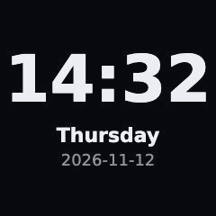

# clock



## What it shows

The time in large digits, below it the weekday and the date. It is the smallest useful page and the starting point for your own pages.

## What you need

Nothing. The page needs no network access, no account and no key.

## Example

```yaml
- type: clock
  lang: en
  refresh: 60
```

## Options

| Key | Default | Meaning |
| --- | --- | --- |
| `lang` | top-level `lang` | `de` or `en`. Sets the language of the weekday and the date format (`14.11.2026` or `2026-11-14`). |
| `duration` | `interval` | How many seconds the page stays on the display. |
| `refresh` | `duration` | How often the page is rendered again. Once a minute (`60`) is enough. |

`duration` and `refresh` work on every page, see [Server configuration](../configuration.md#options-every-page-has). The time zone comes from the top-level `timezone`.

## Setup

1. Add the example above to the `pages:` list in `config.yaml`.
2. Restart the server: `docker compose restart`.
3. Open `http://<server>:8080/` and check the preview.

To build your own page from it, copy `pages/clock` to `pages-custom/mypage` and edit it, as described in [Writing pages](../writing-pages.md).

## Privacy & security

The page makes no network requests and stores nothing. It reads only the server's clock.

## When something is wrong

- **The time is off by an hour:** set the top-level `timezone` (for example `Europe/Berlin`). The default is `Europe/Berlin`.
- **The weekday is in the wrong language:** set `lang: en` or `lang: de` on the page, or the top-level `lang`.
- **The server refuses to start with `lang must be 'de' or 'en'`:** only these two values exist.
