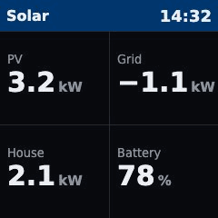
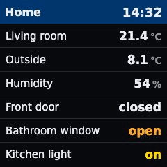

# homeassistant




## What it shows

The current state of up to six entities from your [Home Assistant](https://www.home-assistant.io/), for example solar power, temperatures or open windows.

- **Layout `tiles`:** one to four large values. One value fills the screen, two are stacked, three are one wide tile above two, four are a 2x2 grid. Each tile has a small grey label and the value with its unit below it.
- **Layout `list`:** up to six rows, the label on the left, the value on the right.
- **Numbers** are rounded: whole numbers stay whole, otherwise one decimal place, or exactly `decimals` if you set it. Values in `W` or `Wh` from 1000 on are shown as `kW` or `kWh`. Negative values get a real minus sign (`−1.1 kW`). With `lang: de` the decimal separator is a comma.
- **Words instead of on/off:** door, window, opening and garage door sensors show `open`/`closed`, and `open` is orange. Motion, occupancy and presence sensors show `detected`/`clear`. Lights, switches, `input_boolean`, fans and other binary sensors show `on`/`off`; `on` is yellow for lights and switches. Any other text is shown as Home Assistant sends it.
- **Label:** your `label`, otherwise the entity's friendly name in Home Assistant, otherwise the entity id. Long labels are cut off with `…`.
- **Wide values:** long numbers get a smaller font. Long text is shortened with `…`, so it stays inside its tile or row.
- **One entity unavailable:** that cell shows `n/a` in orange, the others keep working. An entity that does not exist shows `missing` in orange.
- **No connection:** an orange notice `Cannot reach Home Assistant` with the time of the last attempt (`As of 14:32`). The page never keeps showing old values.
- **Token not accepted:** an orange notice `Token rejected` with `Check the long-lived access token`.

The header never turns red.

## What you need

- A running Home Assistant that the Glance Box server can reach over the network.
- A long-lived access token from a Home Assistant user.
- The entity ids you want to show, for example `sensor.pv_power`. You find them in Home Assistant under **Settings → Devices & services → Entities**.

### 1. Create a user for Glance Box (recommended)

A token can do everything its user can (see [Privacy & security](#privacy--security)). So create a separate user for the display instead of using your own account: in Home Assistant go to **Settings → People → Add person**, turn on **Allow login**, and give it a user name and password. Leave **Administrator** off.

### 2. Create a long-lived access token

Log in to Home Assistant as that user. Click your user name at the bottom left, open the tab **Security**, scroll to **Long-lived access tokens** and click **Create token**. Give it a name such as `Glance Box` and copy the token. Home Assistant shows it only once.

### 3. Put the address and token in `.env`

Put both in the file `.env` next to `docker-compose.yml`:

```
HA_URL=http://homeassistant.lan:8123
HA_TOKEN=<the token>
```

Use the address of your Home Assistant in the home network, without `/api` at the end. In `config.yaml` you only write `${HA_URL}` and `${HA_TOKEN}`, see [Secrets and environment variables](../configuration.md#secrets-and-environment-variables).

## Example

Four values as tiles:

```yaml
- type: homeassistant
  url: ${HA_URL}
  token: ${HA_TOKEN}
  title: Solar
  lang: en
  refresh: 30
  entities:
    - entity: sensor.pv_power
      label: PV
    - entity: sensor.grid_power
      label: Grid
    - entity: sensor.house_power
      label: House
    - entity: sensor.battery_level
      label: Battery
```

Six rows as a list, using the names from Home Assistant:

```yaml
- type: homeassistant
  url: ${HA_URL}
  token: ${HA_TOKEN}
  title: Home
  entities:
    - sensor.living_room_temperature
    - sensor.outside_temperature
    - sensor.living_room_humidity
    - binary_sensor.front_door
    - binary_sensor.bathroom_window
    - light.kitchen
```

## Options

| Key | Default | Meaning |
| --- | --- | --- |
| `url` | | Address of your Home Assistant, starting with `http://` or `https://`, without `/api`. Required. Best as `${HA_URL}` from `.env`. |
| `token` | | Long-lived access token. Required. Always as `${HA_TOKEN}` from `.env`, never written into `config.yaml`. |
| `entities` | | List of 1 to 6 entities. Required. Each entry is either an entity id (`sensor.pv_power`) or a mapping with `entity` (required), `label` and `decimals`. An entity id looks like `domain.name` with lower-case letters, digits and `_`. |
| `entities[].label` | friendly name from Home Assistant, otherwise the entity id | Your own label for this entity. |
| `entities[].decimals` | whole numbers stay whole, otherwise 1 | Decimal places, `0` to `3`. |
| `layout` | `tiles` with 1 to 4 entities, otherwise `list` | `tiles` or `list`. `tiles` allows at most 4 entities. |
| `title` | `Home Assistant` | Header text. |
| `lang` | top-level `lang` | `de` or `en`. Sets all texts and the number format. |
| `refresh` | `refresh` default | We recommend `30`. The page asks Home Assistant once per entity on each refresh. |
| `duration` | `interval` | How many seconds the page stays on the display. |

## Setup

1. Put `HA_URL` and `HA_TOKEN` in `.env` as described above.
2. Add the example to the `pages:` list in `config.yaml` with your entity ids.
3. Run `docker compose up -d`. A plain `docker compose restart` does not read `.env` again.
4. Open `http://<server>:8080/` and check the preview.

## Privacy & security

- **The token has all the rights of the user who created it.** Home Assistant has no read-only tokens: a long-lived access token works exactly like a normal access token of that user. Glance Box only reads the states of the entities you list, but someone who gets the token can do more.
- **Even a user without administrator rights can do a lot.** According to the Home Assistant documentation, the built-in groups "Users" and "Administrators" have the same entity permissions: "Users and administrators can control the same entities" ([Permissions](https://contributors.home-assistant.io/core/internals/permissions/)). Administrators can additionally change the configuration. So a token of a non-admin user can still read all entities and switch them. That is why we recommend a separate user for Glance Box: you can see what it does and remove its token or the whole user at any time without touching your own account.
- **Keep the token in `.env` only.** Write `${HA_TOKEN}` in `config.yaml` and never share `.env`. The server sends the token only to your Home Assistant, in the `Authorization` header, and never writes it to its log.
- **Do not expose Home Assistant to the internet just for this page.** The Glance Box server only needs to reach it in your home network.
- Nothing is stored on the Glance Box server beyond the current picture.

## When something is wrong

- **`Cannot reach Home Assistant`:** the server got no usable answer, for example because the address is wrong, Home Assistant is not running or answered with an error. Check `HA_URL` in `.env` and run `docker compose up -d` after changing it. From the server, `curl -H "Authorization: Bearer <the token>" http://homeassistant.lan:8123/api/` must answer `{"message":"API running."}`. The reason is in `docker compose logs`.
- **`Token rejected`:** Home Assistant answered 401 or 403. The token is wrong, was deleted in Home Assistant, or the variable holds something else. Create a new token, put it in `.env` and run `docker compose up -d`.
- **A cell shows `missing`:** Home Assistant does not know this entity id. Check the spelling under **Settings → Devices & services → Entities**. The cell keeps your `label`, otherwise it shows the entity id. If every cell shows `missing`, check that `HA_URL` does not end with `/api`.
- **A cell shows `n/a`:** Home Assistant reports the entity as `unavailable` or `unknown`, or the value is not a real number (`nan`, `inf`). Usually the device behind it is offline. Check the entity in Home Assistant.
- **The server refuses to start and names an option of this page:** the message names the place and what is wrong. `url` must start with `http://` or `https://`; `token` must be set and may not contain spaces or line breaks; `entities` needs 1 to 6 entries with ids like `sensor.name`; `decimals` must be `0` to `3`; `layout: tiles` allows at most 4 entities; `lang` must be `de` or `en`; `title` must be text.
