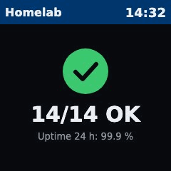
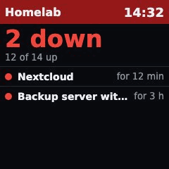

# kuma




## What it shows

The state of an [Uptime Kuma](https://github.com/louislam/uptime-kuma) status page at a glance.

- **Everything up:** a big green check, `14/14 OK` and the average availability of the last 24 hours. Monitors that are still being checked (pending) get an orange line, for example `1 being checked`. Monitors in maintenance count as up.
- **Something down:** the header turns red and shows how many services are down (`2 down`), how many are up, and a row for each failed service with the time since when (`for 12 min`, `for 3 h`, `for 2 d`). Up to four rows fit. More are summarized as `+ 2 more`. If Kuma has no earlier up beat for a service, the time is a lower bound, for example `≥ 40 min`.
- **No connection:** an orange notice `Cannot reach Uptime Kuma` with the time of the last attempt. The page never keeps showing an old "all OK".
- **Empty status page:** the notice `No monitors on this status page`.

Pending and maintenance never turn the header red.

## What you need

- A running Uptime Kuma 2.x that the Glance Box server can reach over the network.
- A status page in Kuma with your monitors on it.

### 1. Install Uptime Kuma

If you do not have it yet, create a `docker-compose.yml` on a machine in your home network:

```yaml
services:
  uptime-kuma:
    image: louislam/uptime-kuma:2
    restart: unless-stopped
    ports:
      - "3001:3001"
    volumes:
      - ./kuma-data:/app/data
```

Start it with `docker compose up -d`, open `http://<host>:3001/` and create the admin account.

### 2. Add monitors

The recommended way is **HTTP(s) monitors** on the web addresses of your services (router page, NAS, Pi-hole, Home Assistant, ...). They need no special rights on anything.

### 3. Create a status page

In Kuma choose **Status Pages**, then **New Status Page**. Give it a name and a **slug** (for example `home`), add your monitors to a group and save. The slug is the last part of the address, `http://<host>:3001/status/home`.

## Example

```yaml
- type: kuma
  url: http://192.168.1.20:3001
  slug: home
  lang: en
  refresh: 30
```

## Options

| Key | Default | Meaning |
| --- | --- | --- |
| `url` | | Address of your Uptime Kuma, starting with `http://` or `https://`, without the `/status/...` part. Required. |
| `slug` | | Slug of the status page: lower-case letters, digits and `-`. Required. |
| `title` | the title of the status page | Header text. |
| `lang` | top-level `lang` | `de` or `en`. Sets all texts on the page. |
| `refresh` | `refresh` default | We recommend `30`. Kuma caches the answer for a minute, so lower values bring nothing. |
| `duration` | `interval` | How many seconds the page stays on the display. |

## Setup

1. Add the example to the `pages:` list in `config.yaml` with your `url` and `slug`.
2. Restart the server: `docker compose restart`.
3. Open `http://<server>:8080/` and check the preview.

## Privacy & security

- **The status page is readable by anyone who can reach Kuma.** The server reads only this public page and needs no login and no key. Do not put monitors on it whose names reveal things you want to keep private, and do not expose Kuma to the internet just for this page.
- Kuma's **Docker container monitor** gives *Kuma* access to Docker, and that is access to your whole machine. Prefer HTTP(s) monitors. If you want container monitors anyway, put a socket proxy with read-only access in between, for example `tecnativa/docker-socket-proxy` with `CONTAINERS=1` and every other permission set to `0`, and never mount the raw `/var/run/docker.sock` into Kuma.
- Nothing is stored on the Glance Box server beyond the current picture.

## When something is wrong

- **`Cannot reach Uptime Kuma`:** the server could not get the status page. Check `url` and `slug`, that Kuma is running, and that the status page is published. From the server, `curl http://<host>:3001/api/status-page/<slug>` must return JSON. The reason is in `docker compose logs`.
- **`No monitors on this status page`:** the status page exists but has no monitors in any group.
- **The server refuses to start and names `slug` or `url`:** the slug may only have lower-case letters, digits and `-`; the url must start with `http://` or `https://`.
- **A service shows `≥ ...`:** Kuma only has down beats for it in the recent history, so the real outage may be longer.
